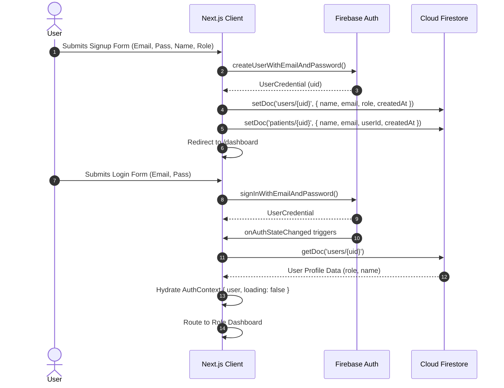

# MEDICORE-AI — Architecture Audit, Security Review & Restoration Plan

> **Date:** November 2026  
> **Repository:** [dj933429-wq/MEDICORE-AI](https://github.com/dj933429-wq/MEDICORE-AI)  
> **Status:** Pre-Restoration Phase (Read-Only Audit Completed)

---

## 1. Complete Existing Project Architecture

MEDICORE-AI is an AI-powered healthcare management platform built on **Next.js 16.2.0** utilizing the **App Router** (`src/app`), **React 19.2.4**, **Tailwind CSS v4**, and **Firebase v12.11.0** (Authentication & Firestore) as a client-side SDK.

```
                      ┌────────────────────────────────────────┐
                      │             Next.js 16 App             │
                      │         (Root Layout + Providers)      │
                      └──────────────────┬─────────────────────┘
                                         │
                   ┌─────────────────────┴─────────────────────┐
                   │                                           │
         [Public Routes]                              [Protected Routes]
       ├── / (Landing Page)                         ├── /dashboard (Role Router)
       ├── /login                                   │     ├── AdminDashboard
       └── /signup                                  │     ├── DoctorDashboard
                                                    │     ├── PatientDashboard
                                                    │     └── /pharmacist
                                                    └── /dashboard/patients/[id]
                                                               │
                                       ┌───────────────────────┴───────────────────────┐
                                       │                                               │
                               [Firebase Client SDK]                           [Next.js API Route]
                              ├── Auth (Email/Password)                    └── /api/ai-assistant
                              └── Firestore (DB & Subcollections)                  └── Google Gemini API
```

### Architectural Key Characteristics
- **Client Components (`'use client'`):** All interactive dashboards, forms, and contexts operate as client components managing local reactive state and interacting with Firebase via the client SDK.
- **Global Auth Guard:** `src/app/providers.tsx` wraps the application in an `AuthProvider` (`src/lib/auth.js`) using `onAuthStateChanged`. `src/app/dashboard/layout.tsx` validates the active session and redirects unauthenticated users to `/login`.
- **Role-Based Routing:** `src/app/dashboard/Dashboard.tsx` checks `user.role` and conditionally renders `AdminDashboard`, `DoctorDashboard`, `PatientDashboard`, or redirects to `/dashboard/pharmacist`.
- **Decoupled AI Health Assistant:** Patient medical AI inquiries route through a secure Next.js server route `/api/ai-assistant` backed by Google's Generative Language API and a curated local triage database (`src/lib/medicalData.ts`).
- **Client-Side OCR:** Pharmacist medicine label scanning is handled entirely on the client side using `tesseract.js` without backend dependencies.

---

## 2. Complete Source Directory Breakdown

```
MEDICORE-AI/
├── .idx/
│   ├── dev.nix                      # Nix workspace environment definition
│   ├── integrations.json            # IDX Gemini integration link
│   └── mcp.json                     # Firebase tools MCP server definition
├── .vscode/
│   └── settings.json                # IDE editor settings
├── public/                          # Static SVG icons and assets
├── src/
│   ├── app/
│   │   ├── api/
│   │   │   └── ai-assistant/
│   │   │       └── route.ts         # Gemini AI proxy with in-memory rate-limiter & local triage
│   │   ├── dashboard/
│   │   │   ├── patients/
│   │   │   │   └── [id]/
│   │   │   │       └── page.tsx     # Dynamic patient records inspection & record creation
│   │   │   ├── pharmacist/
│   │   │   │   └── page.tsx         # Pharmacist dashboard, inventory CRUD, OCR scanner, billing
│   │   │   ├── AdminDashboard.tsx   # Admin user directory & role management view
│   │   │   ├── Dashboard.tsx        # Central role-based dashboard dispatcher
│   │   │   ├── DoctorDashboard.tsx  # Doctor appointments & clinical records workflow
│   │   │   ├── layout.tsx           # Dashboard layout & auth session guard
│   │   │   ├── page.tsx             # Entry page for /dashboard
│   │   │   └── PatientDashboard.tsx # Patient appointments, timeline, billing & AI chat
│   │   ├── login/
│   │   │   └── page.tsx             # User login form
│   │   ├── signup/
│   │   │   └── page.tsx             # User signup form (patient / doctor / pharmacist)
│   │   ├── favicon.ico              # App favicon
│   │   ├── globals.css              # Global styles (Tailwind CSS v4)
│   │   ├── layout.tsx               # Root Next.js layout (wraps app in Providers)
│   │   ├── page.tsx                 # Public landing page
│   │   └── providers.tsx            # Client Provider wrapper for AuthProvider
│   ├── components/
│   │   └── Navbar.tsx               # Global top navigation with brand and logout action
│   └── lib/
│       ├── auth.js                  # Firebase Auth context, login, signup, session sync
│       ├── firebase.js              # Firebase client SDK initialization singleton
│       └── medicalData.ts           # Curated symptom-to-medicine offline lookup dictionary
├── .env.local                       # Local environment variables (revoked/stale credentials)
├── .firebaserc                      # Firebase CLI project targeting file
├── .gitignore                       # Git ignore list
├── AGENTS.md                        # Next.js 16 agent rules
├── blueprint.md                     # Single source of truth project documentation
├── CLAUDE.md                        # Project instructions
├── eslint.config.mjs                # ESLint configuration
├── firebase.json                    # Firebase hosting, auth, firestore configuration
├── firestore.indexes.json           # Firestore composite indexes definition
├── firestore.rules                  # Firestore security rules
├── GEMINI.md                        # AI guidelines for Next.js & Firebase Studio
├── next.config.js                   # Webpack config & env forwarding
├── next.config.ts                   # Duplicate Next.js TS config
├── package.json                     # Dependencies & scripts
├── postcss.config.mjs               # PostCSS Tailwind config
├── README.md                        # General repository documentation
└── tsconfig.json                    # TypeScript compiler options
```

---

## 3. Existing Feature Inventory

| Module | Feature | Implementation Details | Status |
| :--- | :--- | :--- | :--- |
| **Auth** | Sign Up | Creates Firebase Auth user + `users/{uid}` doc + `patients/{uid}` doc | Functional (needs live Firebase) |
| **Auth** | Sign In / Sign Out | `signInWithEmailAndPassword`, `signOut`, context state update | Functional (needs live Firebase) |
| **Auth** | Session Guarding | `DashboardLayout` checks `loading` & `user`, redirects to `/login` | Functional |
| **Admin** | User Directory | Fetches all documents from `users` collection; client-side name/email search | Functional (blocked by Firestore rule) |
| **Doctor** | Appointment Roster | Queries `appointments` where `doctorId == user.uid`, sorted by date/time | Functional |
| **Doctor** | Appointment Status | Updates status (`pending`, `scheduled`, `completed`, `cancelled`) | Functional |
| **Doctor** | Add Medical Record | Modal on scheduled appointments; writes to `patients/{id}/medicalRecords`, marks appointment completed | Functional |
| **Doctor** | Patient History View | Aggregates unique patients from appointments and loads their `medicalRecords` | Functional |
| **Patient** | Profile & Timeline | Fetches `patients/{uid}` and chronological records from `medicalRecords` | Functional |
| **Patient** | Book Appointment | Modal with doctor selector, date/time pickers, and collision detection query | Functional |
| **Patient** | Billing History | Reads `patients/{uid}/bills` for pharmacist-generated invoices | Functional |
| **Patient** | AI Health Chat | Interactive chat window querying `/api/ai-assistant` with auto-scroll | Functional (needs live Gemini key) |
| **Pharmacist** | Inventory CRUD | Add, edit, update stock, and delete in `inventory/{uid}/medicines` | Functional |
| **Pharmacist** | OCR Scanner | `tesseract.js` webcam capture or file upload; extracts name, batch, expiry | Functional (client-side) |
| **Pharmacist** | Billing Engine | Creates bill under `bills` and `patients/{id}/bills`, decrements inventory stock | Functional |
| **General** | Patient Details Page | Dynamic route `/dashboard/patients/[id]` for clinical record reviews | Functional |

---

## 4. Existing Firebase Integration Map

### Client Configuration (`src/lib/firebase.js`)
Initializes Firebase app safely avoiding re-initialization on Next.js hot-reload:
```javascript
const firebaseConfig = {
  apiKey: process.env.NEXT_PUBLIC_FIREBASE_API_KEY,
  authDomain: process.env.NEXT_PUBLIC_FIREBASE_AUTH_DOMAIN,
  projectId: process.env.NEXT_PUBLIC_FIREBASE_PROJECT_ID,
  storageBucket: process.env.NEXT_PUBLIC_FIREBASE_STORAGE_BUCKET,
  messagingSenderId: process.env.NEXT_PUBLIC_FIREBASE_MESSAGING_SENDER_ID,
  appId: process.env.NEXT_PUBLIC_FIREBASE_APP_ID,
};
```

### Firestore Security Rules & Access Mappings (`firestore.rules`)
1. **`/users/{userId}`**:
   - `read`: authenticated users where `role in ['doctor', 'patient', 'pharmacist']`
   - `write`: only the owning authenticated user (`request.auth.uid == userId`)
2. **`/patients/{patientId}`**:
   - `read`: creator (`userId`), assigned doctor (`doctorId`), or any `pharmacist`
   - `write` (update/delete/create): user themselves or assigned doctor
3. **`/patients/{patientId}/medicalRecords/{recordId}`**:
   - `read`, `write`: parent patient owner or assigned doctor
4. **`/patients/{patientId}/bills/{billId}`**:
   - `read`, `write`: pharmacist, patient owner, or assigned doctor
5. **`/bills/{billId}`**:
   - `read`, `write`: any authenticated user
6. **`/appointments/{appointmentId}`**:
   - `create`: patient creating for themselves (`patientId == request.auth.uid`)
   - `read`, `update`: either the patient or the doctor involved
7. **`/inventory/{userId}/medicines/{medicineId}`**:
   - `read`, `write`: pharmacist owner (`request.auth.uid == userId`)

---

## 5. Existing Authentication Flow



---

## 6. Existing Firestore Data Model

```
Cloud Firestore
├── users/{userId}
│     ├── name: string
│     ├── email: string
│     ├── role: "admin" | "doctor" | "patient" | "pharmacist"
│     ├── doctorId?: string (optional assignment)
│     └── createdAt: ISO timestamp string
│
├── patients/{patientId} (where patientId == userId)
│     ├── name: string
│     ├── email: string
│     ├── phone: string
│     ├── userId: string
│     ├── doctorId?: string
│     ├── createdAt: ISO timestamp string
│     │
│     ├── [subcollection] medicalRecords/{recordId}
│     │     ├── diagnosis: string
│     │     ├── medicines: string
│     │     ├── notes: string
│     │     ├── doctorId: string (or doctor: string)
│     │     └── createdAt: serverTimestamp() | date: string
│     │
│     └── [subcollection] bills/{billId}
│           ├── items: [ { id, medicineId, name, price, quantity, total } ]
│           ├── totalAmount: number
│           ├── pharmacistId: string
│           └── createdAt: serverTimestamp()
│
├── appointments/{appointmentId}
│     ├── patientId: string
│     ├── patientName: string
│     ├── doctorId: string
│     ├── doctorName: string
│     ├── date: string ("YYYY-MM-DD")
│     ├── time: string ("HH:MM")
│     ├── status: "pending" | "scheduled" | "completed" | "cancelled"
│     ├── notes: string
│     ├── recordAdded?: boolean
│     └── createdAt: serverTimestamp()
│
├── inventory/{pharmacistUid}/medicines/{medicineId}
│     ├── name: string
│     ├── batch: string
│     ├── expiry: string
│     ├── stock: number
│     ├── createdBy: string
│     └── createdAt: Timestamp / Date
│
└── bills/{billId}
      ├── patientId: string
      ├── items: [ { id, medicineId, name, price, quantity, total } ]
      ├── totalAmount: number
      ├── pharmacistId: string
      └── createdAt: serverTimestamp()
```

---

## 7. Existing Gemini Integration Status

- **Package:** `@google/generative-ai` (`^0.24.1`) is installed in `package.json`, but the active route uses direct HTTP REST calls to the Generative Language API.
- **Active Endpoint:** `src/app/api/ai-assistant/route.ts`:
  - In-memory rate limiting: 15 requests/minute per client IP (`x-forwarded-for`).
  - Offline clinical triage: Matches user input keywords against `src/lib/medicalData.ts` (fever, cold, headache, cough).
  - Dynamic model discovery: Queries `https://generativelanguage.googleapis.com/v1beta/models?key=${apiKey}` and dynamically selects the best supported model (`gemini-1.5-flash`, `gemini-1.5-pro`, `gemini-1.0-pro`, or `gemini-pro`).
  - Prompt structure: Instructs the model to act as a safe, basic rural healthcare assistant with disclaimers.
- **Removed OCR Endpoint:** Legacy `/api/scan-medicine/route.ts` was deleted in commit `cee62b5` in favor of client-side `tesseract.js`.
- **CRITICAL CLIENT-SIDE LEAK FINDING:** `next.config.js` contains:
  ```javascript
  env: {
    GEMINI_API_KEY: process.env.GEMINI_API_KEY,
  }
  ```
  In Next.js, keys in `nextConfig.env` are bundled into client-side JavaScript. This must be eliminated.

---

## 8. Environment File & Security Audit

### 1. Git Tracking & Ignore Status
- `.env*` is included in `.gitignore`.
- Neither `.env` nor `.env.local` is currently tracked in the Git index.
- There is **no `.env.example`** template in the repository.

### 2. Accidental Leaks in Git History
- **`firebase-debug.log` in commit `5757dc0`:**
  Committed in the initial commit. While deleted locally, it is tracked in Git, leaving unstaged deletion warnings. The log contains user email identities and API authorization command scopes.
- **`next.config.js` client-side forwarding:**
  Exposes `GEMINI_API_KEY` to client bundles through `nextConfig.env`.

### 3. Git History Cleanup Recommendation
- Untrack and ignore debug logs: `git rm --cached firebase-debug.log` and add `*.log` to `.gitignore`.
- Remove the `env: { GEMINI_API_KEY }` block from `next.config.js`.
- Clean commit history if public publishing is intended (e.g. using `git filter-repo` to purge any historical log traces).

---

## 9. List of Broken or Missing Integrations

1. **Revoked Firebase Credentials:**
   `.env.local` holds revoked API keys and IDs. All auth and database calls currently fail.
2. **Next.js Production Build Failure (`next build`):**
   `npm run build` runs `next build` which defaults to Turbopack. On Windows x64 without precompiled native SWC binaries, Turbopack fails. It requires the `--webpack` flag (as used in `npm run dev`).
3. **Duplicate & Conflicting Next Configs:**
   Both `next.config.js` and `next.config.ts` exist in the root, causing warnings and config ambiguity.
4. **Corrupted Type Definition in `node_modules`:**
   `npx tsc --noEmit` fails on `node_modules/sharp/lib/index.d.ts` (unclosed comment syntax).
5. **ESLint Violations (16 errors):**
   - `src/app/dashboard/Dashboard.tsx:45`: Modifying `window.location.href` directly inside render instead of in a `useEffect` hook.
   - Multiple `@typescript-eslint/no-explicit-any` usages across route and dashboard components.
6. **Firestore Rules Limitations:**
   - `AdminDashboard.tsx` reads all users from `users` collection, but `firestore.rules` does not grant `admin` role read access across the whole collection.
   - Subcollection record field discrepancies: `DoctorDashboard` writes `createdAt: serverTimestamp()`, while `PatientDetailPage` writes `date` string and expects `doctor` string instead of `doctorId`.

---

## 10. Precise Step-by-Step Restoration Plan

### Step 1: Security & Workspace Sanitization
1. Create a clean `.env.example` with placeholder variables.
2. Remove `firebase-debug.log` from Git tracking and update `.gitignore` to ignore all `*.log` files.
3. Remove `env: { GEMINI_API_KEY }` from `next.config.js` and consolidate Next config into a single file to eliminate conflicts and prevent client-side key leakage.
4. Update `package.json` build script to `"build": "next build --webpack"`.

### Step 2: Clean Firebase Project Configuration
*(Awaiting new Firebase project credentials)*
1. Populate `.env.local` with fresh, active project credentials:
   - `NEXT_PUBLIC_FIREBASE_API_KEY`
   - `NEXT_PUBLIC_FIREBASE_AUTH_DOMAIN`
   - `NEXT_PUBLIC_FIREBASE_PROJECT_ID`
   - `NEXT_PUBLIC_FIREBASE_STORAGE_BUCKET`
   - `NEXT_PUBLIC_FIREBASE_MESSAGING_SENDER_ID`
   - `NEXT_PUBLIC_FIREBASE_APP_ID`
   - `GEMINI_API_KEY`
2. Update `.firebaserc` with the new project ID.

### Step 3: Firebase Authentication & Role Verification
1. Enable Email/Password provider in the Firebase Console.
2. Test user registration for each role (`patient`, `doctor`, `pharmacist`).
3. Verify that `users/{uid}` and `patients/{uid}` documents are accurately auto-provisioned upon registration.

### Step 4: Cloud Firestore Rules & Indexes Deployment
1. Update `firestore.rules` to:
   - Allow `admin` users to read the `users` directory.
   - Maintain strict doctor-patient subcollection isolation.
2. Deploy or apply the Firestore rules and composite indexes defined in `firestore.indexes.json`.

### Step 5: Dashboard & Integration Verification
1. Verify **Doctor Dashboard**: appointment status updating and medical record creation.
2. Verify **Patient Dashboard**: appointment booking, medical timeline display, and bill viewing.
3. Verify **Pharmacist Dashboard**: inventory management, Tesseract OCR label scanning, and invoice generation.
4. Verify **Admin Dashboard**: user directory rendering and role inspection.

### Step 6: Gemini AI Assistant Verification
1. Test `/api/ai-assistant` with active `GEMINI_API_KEY`.
2. Confirm both the local triage matching and the live fallback Gemini responses work in the patient chat UI.

### Step 7: Lint & Build Validation
1. Fix ESLint errors (redirect hook in `Dashboard.tsx`, type assertions).
2. Run `npm run lint` and verify clean output.
3. Run `npm run build` with `--webpack` and verify a successful production build.

### Step 8: Gate Check & Phase 4 Preparation
1. Update `blueprint.md` to document the restored state.
2. Await final sign-off before proceeding to **Phase 4 (Menstrual Health & Blood Bank Management)**.
